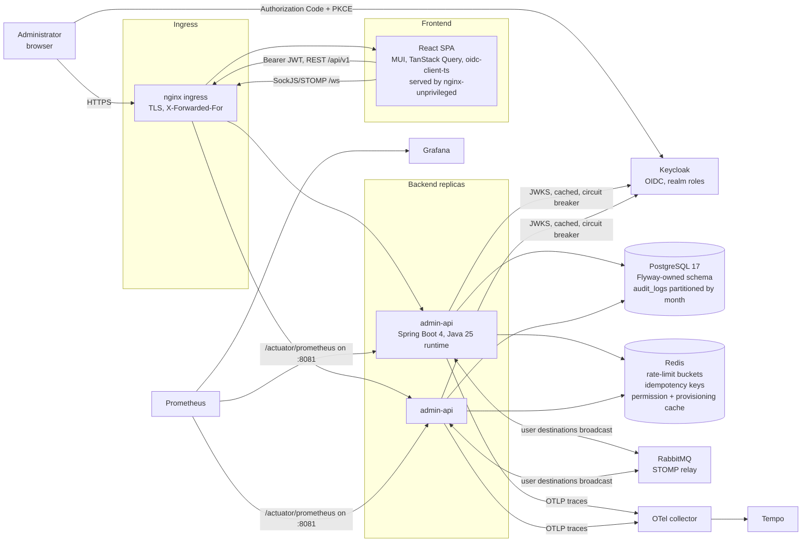

# Architecture

ProjectAdmin is an administration product: a React single-page application,
a Spring Boot API, Keycloak for identity, PostgreSQL for data, and Redis plus
RabbitMQ so the API can run as several interchangeable replicas.

## Containers (C4 level 2)



## Request path inside the API

```mermaid
sequenceDiagram
  participant C as Client
  participant F as Filters
  participant S as Security
  participant U as AppJwtAuthenticationConverter
  participant M as Method security
  participant B as Use case / service
  participant D as PostgreSQL

  C->>F: HTTP request (+ correlation id)
  F->>S: ApiKeyAuthenticationFilter (X-Api-Key) or BearerTokenAuthenticationFilter (JWT)
  S->>U: authenticated principal
  U->>D: link subject -> users row, once per request into the CurrentUser principal (cached per subject)
  U->>F: RateLimitFilter (per subject, Redis) then IdempotencyFilter (per subject+path+key)
  F->>M: @PreAuthorize: hasRole('ADMIN') or hasAuthority('user.write') or @ownership.*(#id, authentication)
  M->>B: transactional use case (@Audited, @Version check)
  B->>D: read / write
  B-->>C: ApiResponse envelope (data, pagination, correlationId)
  Note over B,D: audit row written in the same transaction; after commit: cache invalidation event, WebSocket push
```

## Module graph

Two Maven modules, `platform` (library) and `app`; inside `app`, Spring Modulith modules (ADR 0004):

```
app (shell: security, config, cache, error catalog)
  -> identity, access, organization, configuration, content, notification, audit
access, organization, configuration, content, notification, audit -> identity   (facade, ids)
configuration -> organization                                                  (facade, ids)
every module -> platform, shared                                                (open modules)
```

No cycles and no cross-module `internal` import, enforced by `ModularityTest`; layer rules inside a module by `ArchitectureTest`.

## Where things live

| Concern | Location |
|---|---|
| Identity and provisioning | `identity` module (`UserProvisioningService`, `IdentityFacade`); the `CurrentUser` principal is built once per request by `app/security/AppJwtAuthenticationConverter` (ADR 0001, ADR 0006) |
| Authorization rules | `@PreAuthorize` on every mutating use case and its endpoint, expressions from `shared/security/Authorize` (`hasRole('ADMIN') or hasAuthority('<resource>.<action>')`); the permission codes come from `user_roles` and `role_permissions`, resolved once at authentication by `access/UserPermissionsQuery` and cached until the next `AccessChanged` (ADR 0006); `app/security/OwnershipSecurity` and `SessionSecurity` answer ownership through the domain facades |
| Access-management operations | `access` module use cases (`AssignRoleToUser`, `GrantPermissionsToRole`, `RevokeUserAccess`, `EffectivePermissionsQuery`), exposed by `RbacController` |
| Per-domain CRUD | `<module>/internal/application/*Service`, `<module>/internal/web/*Controller` |
| Shared state (multi-replica) | `platform/ratelimit`, `platform/idempotency`, Redis cache (`app/config/CacheConfig`, `app/cache`), ShedLock (`app/config/SchedulingConfig`), all switched by `fourati.common.store` (ADR 0008) |
| WebSocket push | `app/config/WebSocketConfig` (simple broker or RabbitMQ relay), `notification` module (`UserNotificationService`) |
| Audit trail | `platform/audit/AuditAspect` -> `audit` module `AuditLogEventListener` (same transaction), `AuditLogPartitionJob`, ADR 0003, ADR 0007 |
| Schema | `app/src/main/resources/db/migration` (Flyway, V1..V17) |
| Observability | `application.yml` (`management.*`), `deploy/observability/*` |
| Deployment | `docker-compose.yml` (profiles), `deploy/k8s` (Kustomize base + overlays) |
| Load test and SLOs | `deploy/loadtest/k6-api.js` |

## Environments

| Profile | Where | Store | Broker | Tracing | Docs |
|---|---|---|---|---|---|
| `dev` | IDE + compose `infra` | Redis | RabbitMQ relay | off | Swagger on |
| `docker` | compose `app` / `scale` | Redis | RabbitMQ relay | on with `observability` profile | Swagger on |
| `staging` | Kubernetes overlay | Redis | RabbitMQ relay | on | off |
| `prod` | Kubernetes overlay, managed services | Redis | RabbitMQ relay | on | off |
